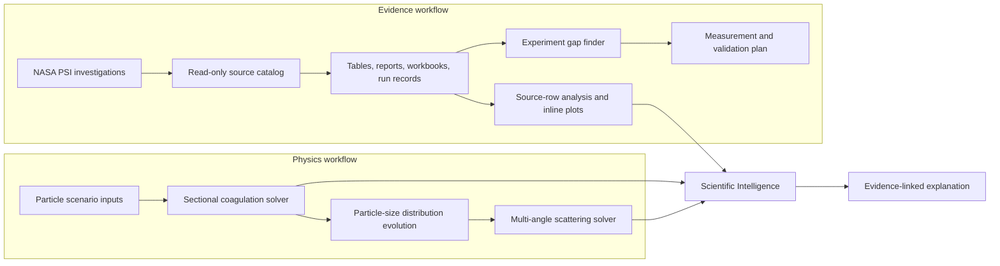
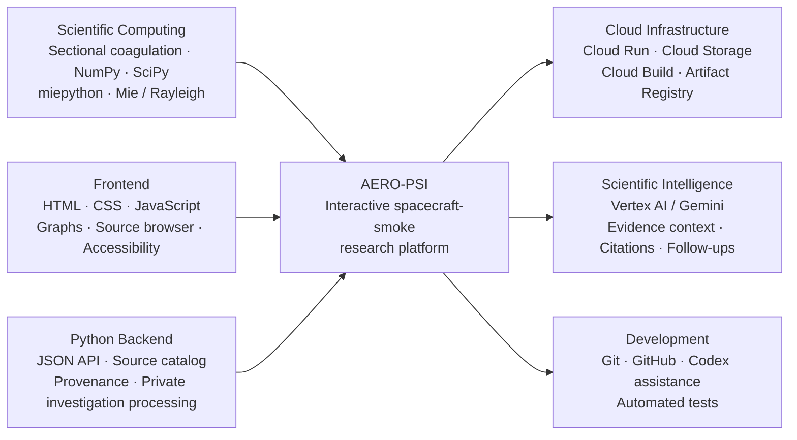

# AERO-PSI

### Aerosol Evidence, Coagulation, Scattering, and Experiment Intelligence for Spacecraft Smoke Research

**NASA Space Apps Challenge 2026** · **Flame in Freefall** · **Team DECODE101** · Solo-developed project

**[Explore the live platform](https://aeropsi.cloud.run/)** 

> **From smoke signals to scientific insight.** AERO-PSI connects NASA combustion evidence, numerical aerosol models, optical scattering, and evidence-aware scientific interpretation in a single research environment.


## Table of Contents

- [The Problem](#the-problem)
- [What AERO-PSI Does](#what-aero-psi-does)
  - [NASA Evidence Explorer](#1-nasa-evidence-explorer)
  - [Aerosol Coagulation Model](#2-aerosol-coagulation-model)
  - [Multi-Angle Optical Scattering](#3-multi-angle-optical-scattering)
  - [Experiment Gap Finder and Scientific Intelligence](#4-experiment-gap-finder-and-scientific-intelligence)
  - [Investigation Studio](#5-investigation-studio)
- [A Connected Research Workflow](#a-connected-research-workflow)
- [Technical Architecture](#technical-architecture)
- [NASA Evidence and Scientific Resources](#nasa-evidence-and-scientific-resources)
- [Getting Started](#getting-started)
  - [Try the Hosted App](#try-the-hosted-app)
  - [Run Locally](#run-locally)
  - [Verification](#verification)
- [Repository Layout](#repository-layout)
- [Cloud Data, Deployment, and Privacy](#cloud-data-deployment-and-privacy)
- [Scientific Validity and Limitations](#scientific-validity-and-limitations)
- [Why It Matters](#why-it-matters)
- [Credits and AI-Assisted Development](#credits-and-ai-assisted-development)


## The problem

Spacecraft fire and smoke research is difficult to interpret from isolated measurements alone. Smoke concentration, particle characteristics, optical signals, gas flow, instrument status, and scientific reports may describe different aspects of the same experiment. In microgravity, reduced gravitational settling also changes particle transport and removal, making terrestrial assumptions potentially incomplete.

AERO-PSI aims to help researchers and students move from **what an experiment recorded**, to **what a physics model can explore**, to **what further evidence would be needed to test an explanation**. The platform uses NASA's Physical Sciences Informatics (PSI) resources and related research documentation, while clearly separating observations, calculations, hypotheses, and uncertainty.

## What AERO-PSI does

### 1. NASA Evidence Explorer


The evidence explorer provides a searchable, read-only view of supplied NASA experiment resources, including experimental tables, run workbooks, housekeeping records, reports, presentations, and investigation metadata. Its indexed sources include SAME-R (PSI-101), SAME (PSI-102), BASS/BASS-II, FLEX, ACME, SAFFIRE, and supporting fire-safety research.

- Inspect original filenames, worksheet rows and columns, source types, reported units, material context, and available run conditions.
- Examine numerical signals with computed summaries: extrema, first-to-last changes, missing values, possible instrument sentinel values, and operating-state transitions.
- View contextual plots and supporting documents without substituting generated measurements for original NASA data.
- Preserve original paths and traceability; display labels do not change source records or certify their scientific meaning.

### 2. Aerosol Coagulation Model


The aerosol model uses a **sectional Smoluchowski population-balance approach** to explore the evolution of smoke-particle populations under specified conditions. Inputs include an initial size distribution, gas conditions, gravity scenario, particle density, sticking efficiency, residence time, and selected source, growth, settling, and removal assumptions.

- Simulate collisions across logarithmic particle-size sections.
- Track particle number, surface area, volume, mass, equivalent volume-mean diameter, source/loss budgets, and numerical overflow.
- Compare microgravity, intermediate-gravity, and terrestrial-gravity scenarios, with clearly identified assumptions.
- Inspect conservation and size-grid sensitivity diagnostics.

**Important:** Gravity can change particle settling and transport. It is **not** simply a direct multiplier applied to the intrinsic Brownian coagulation kernel. Gravity-scenario outputs are model-based explorations, not experimentally validated forecasts for lunar or Martian habitats.

### 3. Multi-Angle Optical Scattering


The optical module estimates how assumed **spherical** particle populations interact with light across viewing angles and wavelengths. It uses `miepython` for Mie calculations, with Rayleigh behavior considered in the applicable small-particle regime.

- Adjust size distributions, particle concentrations, wavelength, complex particle refractive index, medium refractive index, and observation angle.
- Plot theoretical angular scattering responses.
- Explore an assumed distribution or reuse one produced by the coagulation solver.
- Examine how changes in size distributions may alter **modeled** detector-relevant optical behavior.


### 4. Experiment Gap Finder and Scientific Intelligence


The gap finder turns a scientific question into an evidence-review and experiment-planning workflow. It identifies relevant indexed investigations, the available measurements and report passages, and missing or uncertain information that could strengthen a proposed comparison.

- Inspect whether particle concentration, size distribution, flow, aging, temperature, pressure, gravity, wall losses, and calibration information are documented in selected sources.
- Generate a structured measurement or validation plan for unresolved hypotheses.
- Keep **basic evidence checking** distinct from an **AI-assisted review**.
- Interpret gaps as limitations of the **indexed/supplied evidence**, not proof that NASA or the wider literature has never investigated a topic.

**Scientific Intelligence (SI)** is provided through Google Vertex AI / Gemini. It helps explain scientific concepts, summarize selected reports or data, interpret deterministic model outputs, maintain question context, and provide source-aware follow-up answers. For table discussions, the backend supplies computed summaries, inline plots and source-row references; AI explanations are not used as substitutes for numerical calculation.

### 5. Investigation Studio


An integrated workspace lets visitors create and revise research studies, attach evidence and calculated outputs, track investigation steps, and export records. Studies are saved privately in the current browser's **IndexedDB** rather than automatically synchronized across devices. Browser storage can be cleared, so exported copies are recommended for important work.

## A connected research workflow

AERO-PSI has **four primary analysis capabilities**—evidence exploration, coagulation, scattering, and gap finding—connected by a scientific-intelligence layer. The two input streams are NASA source evidence and user-defined particle scenarios.



**How to explore it:** Select a NASA investigation and examine its source records, simulate a particle population with documented assumptions, inspect its modeled optical response, then ask SI to explain the selected evidence or calculation. The gap finder can help identify what further measurements would be needed to test the proposed interpretation.


## Technical architecture

The project is a Python-backed web application, **not** a React or FastAPI application. Its frontend uses HTML, CSS, and JavaScript; the backend uses a Python standard-library HTTP server and a structured JSON API.



| Area | Implementation |
|---|---|
| Frontend | HTML, CSS, JavaScript, interactive plots, accessible dark/light themes |
| Backend | Python, JSON API, source-analysis and model workflows |
| Numerical computing | NumPy, SciPy, sectional Smoluchowski coagulation |
| Optical calculations | `miepython`, Mie scattering and applicable Rayleigh approximations |
| Scientific intelligence | Google Vertex AI / Gemini |
| Hosting | Google Cloud Run (frontend and API served together) |
| Research data | Google Cloud Storage and verified local runtime snapshots |
| CI/build & delivery | Cloud Build, Artifact Registry, Git/GitHub |
| Verification | Python unit tests and Playwright browser checks |

## NASA evidence and scientific resources

The project uses publicly documented research from the NASA PSI repository and related NASA sources. The **complete original scientific archive is not part of this public Git repository**.

| Investigation | NASA source | Research relevance |
|---|---|---|
| SAME-R / PSI-101 | [PSI-101](https://psi.nasa.gov/physci/repo/data/investigations/PSI-101) | Smoke aerosol measurements, flight/ground research |
| SAME / PSI-102 | [PSI-102](https://psi.nasa.gov/physci/repo/data/investigations/PSI-102) | Smoke characteristics and detection-related studies |
| BASS / PSI-26 | [PSI-26](https://psi.nasa.gov/physci/repo/data/investigations/PSI-26) | Solid-fuel combustion research |
| BASS-II / PSI-25 | [PSI-25](https://psi.nasa.gov/physci/repo/data/investigations/PSI-25) | Solid-fuel flame behavior |
| FLEX / PSI-69 | [PSI-69](https://psi.nasa.gov/physci/repo/data/investigations/PSI-69) | Droplet combustion and extinction |
| SAFFIRE-I / PSI-98 | [PSI-98](https://psi.nasa.gov/physci/repo/data/investigations/PSI-98) | Spacecraft fire-safety research |
| ACME / PSI-10 | [PSI-10](https://psi.nasa.gov/physci/repo/data/investigations/PSI-10) | Flame Design experiment |
| ACME / PSI-159 | [PSI-159](https://psi.nasa.gov/physci/repo/data/investigations/PSI-159) | Cool Flames Investigation with Gases |
| SoFIE | [NASA Technical Reports Server](https://ntrs.nasa.gov/citations/20200000361) | Solid-fuel ignition and extinction background |

Additional scientific references include [NIST smoke particle sizing research](https://www.nist.gov/publications/moment-method-obtaining-particle-size-measures-test-smokes), [NIST light scattering research](https://www.nist.gov/publications/light-scattering-characteristics-and-size-distribution-smoke-and-nuisance-aerosols), and the [`miepython` documentation](https://miepython.readthedocs.io/).

## Getting started

### Try the hosted app

Open **[aeropsi.cloud.run](https://aeropsi.cloud.run/)**. No local NASA archive installation is needed to explore the publicly deployed application.

Suggested walkthrough:

1. Browse an investigation in the NASA Evidence Explorer.
2. Open a source table or run record and inspect its reported quantities and references.
3. Run a coagulation scenario and review the distribution and diagnostics.
4. Explore the theoretical multi-angle scattering response.
5. Open Investigation Studio or ask Scientific Intelligence for a context-aware explanation.

### Run locally

**Recommended runtime:** Python 3.13 (to match the deployment environment).

```bash
python3 -m venv .venv
.venv/bin/python -m pip install -r requirements-deploy.txt
cp .env.example .env
```

Configure `.env` for your Google Cloud project, Vertex AI location/model, and data source. Authentication uses **Google Application Default Credentials (ADC)**: do not commit credentials, API secrets, or `.env` files.

Select **one** scientific data source:

- **Cloud Storage:** Set `AERO_PSI_STORAGE_BUCKET=aeropsi-data` (the bucket configured for this deployment); the authenticated identity must have bucket read access and any required Vertex AI permissions.
- **Local data:** Set `AERO_PSI_STORAGE_BUCKET=` (empty) and provide the expected `DATA/`, `aero_psi_catalog.json`, and relevant `derived/` artifacts. `python -m aero_psi index` rebuilds the catalog from local sources, but it **does not** perform every ingestion or document-extraction step.

Start the app:

```bash
.venv/bin/python -m aero_psi serve
```

Open **http://127.0.0.1:8000/**. Health check: **`GET /api/v1/health`**.

Disable live SI calls for local testing by setting `AERO_PSI_COPILOT_ENABLED=false`.

### Verification

Run Python tests:

```bash
.venv/bin/python -m unittest discover -s tests
```

Browser checks require Node.js, Playwright, and an installed browser. For example, with the app running:

```bash
AERO_PSI_TEST_URL=http://127.0.0.1:8000 \
CHROME_PATH='/Applications/Google Chrome.app/Contents/MacOS/Google Chrome' \
node tests/browser_private_storage.cjs
```

Additional model examples are provided in `examples/scattering.json` and `examples/coupled_optics.json`. Live SI requests may incur cloud usage charges.

## Repository layout

| Path | Contents |
|---|---|
| `aero_psi/` | Python HTTP API, scientific models, evidence retrieval, SI, cloud-data initialization |
| `frontend/pages/` | HTML page templates |
| `frontend/js/` | Browser interactions, plots, storage, SI interface |
| `frontend/styles/` | Responsive styles, themes, accessibility options |
| `frontend/components/`, `frontend/assets/`, `frontend/vendor/` | Shared interface code, assets, bundled dependencies |
| `mappings/`, `mappings/source_labels.json` | Source-linked labels, verified mappings, readable titles |
| `tools/` | Packaging, source review, deployment utilities |
| `tests/` | Scientific/API regression and browser checks |
| `examples/` | Example simulation request payloads |
| `deploy/` | Deployment scripts and [deployment guide](deploy/README.md) |
| `Dockerfile`, `.dockerignore`, `.gcloudignore` | Container and upload configuration |
| `requirements.txt`, `requirements-deploy.txt` | Dependency specifications |

**Source integrity:** `mappings/source_labels.json` controls presentation labels and tags. It does not alter original filenames, source identities, units, checksums, or verified run joins. Unresolved identities are left ambiguous rather than guessed.

## Cloud data, deployment, and privacy

The application serves the frontend and backend together from **Google Cloud Run**. Google Cloud Storage stores the allowlisted research runtime snapshot, including the NASA source archive, catalog, selected derived time series, evidence excerpts, and ingestion manifest. This is separate from the public GitHub code repository.

At startup, the backend retrieves a scientific snapshot and verifies object size and SHA-256 checksums. Cached objects can be reused within an instance, but a fresh Cloud Run instance must initialize its own runtime cache. The Cloud Storage archive is **not** a live filesystem mount. Data changes require the appropriate runtime restart or redeployment. Authentication or verification errors should fail visibly rather than silently substituting different evidence.

The original README documents an approximately **761 MB** runtime archive at the time it was written; treat that as a historical snapshot size, not a fixed guarantee.

See [deploy/README.md](deploy/README.md) for deployment steps. Cloud hosting, storage, and Vertex AI calls can incur charges; instance limits are not hard spending caps.

**Private investigations:** Investigation Studio stores visitor studies in the current browser's **IndexedDB**. They are not synchronized across devices, and clearing browser data or using private browsing may remove access. Relevant records can be transmitted for request-scoped computation or SI processing, but the backend does not maintain a shared server-side visitor-investigation library. Export studies you need to keep.

## Scientific validity and limitations

AERO-PSI is an **exploratory research platform**, not an operational fire detector or certified spacecraft-safety system.

| Evidence category | Interpretation |
|---|---|
| **Observed** | Values from cited source files and rows; may still require calibration/context |
| **Computed** | Deterministic numerical results and descriptive summaries |
| **Modeled** | Physics predictions dependent on stated assumptions and solver settings |
| **SI interpretation** | AI-assisted explanation grounded in selected context; not independently verified solely by citation presence |
| **Unresolved** | Missing data, uncertain conditions, or hypotheses requiring future investigation |

Additional boundaries:

- Numerical checks, sensitivity testing and conserved-quantity diagnostics support software verification, but **do not establish experimental validation** by themselves.
- A close-looking experimental trend is not sufficient to infer causation or claim that a model is fitted to a NASA run.
- The optical module assumes spheres; actual smoke may contain complex aggregates and detector geometry effects not represented by Mie/Rayleigh outputs alone.
- Summaries of source rows distinguish invalid/sentinel entries, missing observations, and sampled plots from statistics over full tables.
- Gap-finding claims apply to the supplied/indexed sources, not to the entirety of NASA research.
- Source identity/citation checks do not independently prove every SI-generated scientific statement.

Preserve NASA source originals. Do not write generated data into the `DATA/` source directory; keep processed outputs in separate runtime locations.

## Why it matters

AERO-PSI aims to make spacecraft fire and smoke-aerosol research more understandable, traceable, and useful for future experiment design. Smoke aerosols matter for crew safety, visibility, filtration, contamination control, and detection systems, but interpreting experimental evidence often requires connecting particle physics, optical effects, instrument limitations, and operating conditions.

By combining accessible research exploration with deterministic numerical modeling and evidence-aware SI, AERO-PSI could help students, researchers, and mission designers identify what an experiment shows, explore a possible physical mechanism, and decide which measurements could strengthen the next investigation. Its gravity scenarios are **exploratory**, with future use in lunar and Martian research dependent on appropriate scientific validation.

## Credits and AI-assisted development

**NASA Space Apps Challenge 2026 — Flame in Freefall** · **Team DECODE101** · Solo-developed entry.

NASA PSI and associated public research resources supplied the scientific source material; original sources remain credited and linked above. Additional technical references are acknowledged in their corresponding sections.

**Codex** supported selected development, debugging, testing, and documentation tasks. **Google Gemini** supported preliminary ideation and scientific review. **Vertex AI / Gemini** powers the platform's evidence-aware Scientific Intelligence features. Numerical results are computed by scientific software, not by AI text generation.

The platform is an independent research prototype, not a NASA-operated or NASA-certified product.

